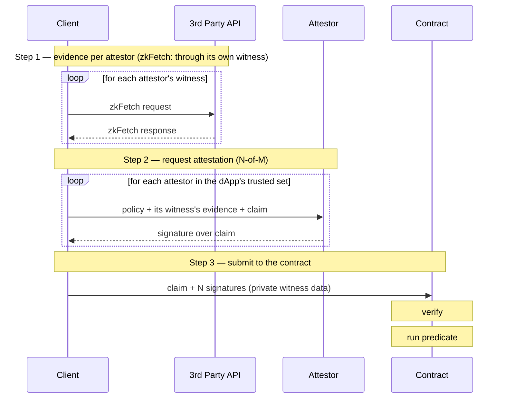

# Thoth Design

## Overview

Midnight contracts rely on private data that is provided by the user's machine when
needed and it is not stored in-contract. Sometimes this data is expected to come
from an external source, and it is desirable to be able to assure that it is legit,
while preserving the privacy. From this stem two requirements that must hold at once:

- ensuring that a certain claim is true
- keeping selected data private

"Private" is precise, and differs by piece of data:

- **Private credentials** (API keys, cookies, auth headers) never leave the user's
  machine — the fetch mechanism redacts them.
- **The evidence** (e.g. a zkFetch proof) is what the attestor sees: the *disclosed*
  values the claim is derived from, but not the credentials and not anything the
  fetch redacted.
- **The claim values** are private witness data in the Midnight contract — they never
  appear on-chain; only the predicate outcome and any commitments do. They are not
  hidden from guessing, though: the replay nullifier is an unsalted hash over the
  observation, so anyone can confirm a guessed value — easy for an enumerable
  identifier in a byte slot (ADR 0009).

To establish that a claim is true, the client obtains evidence from a *data source* —
e.g. a third-party API — via a protocol such as Reclaim Protocol's ZkFetch, which
fetches the data and generates a zero knowledge proof that the connection took place
and that the data retrieved wasn't forged.

The *attestor* is the entity that verifies such evidence: given evidence the client
obtained, the attestor checks it and, if satisfied, signs a claim derived from it with
its own key — its signature is the attestation. Attestors are defined by the *kind* of
verification they can perform:

- **zkFetch** — verifies a client's fetch proof from a data source; this kind
  ships as [`@thoth/zk-tls`](https://github.com/txpipe-shop/thoth/tree/main/packages/zk-tls)
- **effectStream** — certifies events observed on another blockchain
- **band** — checks a client-proposed value against the attestor's own data source,
  within a bound
- **trusted hardware / devices** — further kinds, where the proof comes from hardware
  or a device

The client calls the attestors whose kind matches how the claim was obtained.

**Band attestors.** When no client-side proof exists, the client proposes a value and
the attestor checks it against its own data source, signing only that the value is
valid within a bound. N band attestors agreeing on the same value give the app
independent corroboration rather than cryptographic proof.

Attestors certify facts, not decisions: a claim is a canonical statement of what was
observed, and the application defines the predicate over it. Attestors are generic
infrastructure, shared across applications: an attestor holds no application's policy
and accepts requests from any protocol that reaches it, as long as the evidence comes
from the witness it trusts. Attestors never know how a claim is used, so the same
attested value can feed different predicates in different applications.

What makes a claim meaningful is the consuming contract. The app pins its trusted
attestor set and threshold at deploy time, and its predicate decides which claims it
accepts. A claim carries `policyHash`, which the contract checks against its sealed
set, and `subjectHash`, a circuit hash of what the claim is about. Matching values do
not by themselves prove where they came from: an app that needs source binding supplies
the subject privately, recomputes `subjectHash` in-circuit, and pins only the fields
its policy needs, such as the host.

On the other side is the *client* — the component that runs on the user's machine,
inside the dApp. It first obtains evidence of a fact. In the zkFetch kind that means
one fetch per attestor in its trusted set, each through that attestor's own Reclaim
witness; the client keeps only what the witnesses agree on. It then sends each
attestor the evidence its own witness produced, collects the N signatures the dApp's
deploy-time threshold requires, and hands the claim together with those signatures to
the Midnight contract as private witness data. The contract's predicate runs over the
attested values without any of them ever being revealed on-chain.

Of course, relying on one single attestor would be almost the same as having no
attestors at all, so our approach aims to create an *attestor network* that can be
pinged by any dApp that needs to use external data in-contract. Each dApp chooses its
own threshold at deployment time, meaning how many attestors'
signatures are needed for a claim to be valid.

Every claim is signed for one app: it carries the app's `appId`. Within one
app, the same claim can feed any number of predicates.

To add a kind, see [kind-author-guide.md](kind-author-guide.md).

## The claim

The claim is the same object everywhere — client, attestors, and contract —
and it is the whole signed message: anything the contract checks is a field of
it. The terms are defined in [`CONTEXT.md`](../CONTEXT.md); the decisions
behind them are the ADRs in [`adr/`](adr/).

| Field | What it is |
|-------|------------|
| `version` | Wire version, `1` until a layout is deployed |
| `appId` | The app the claim is for |
| `policyHash` | Hash of the policy the attestors enforced; stands in for the kind (ADR 0002) |
| `windowStart`, `windowEnd` | When the attestor observed, in Unix seconds (ADR 0005) |
| `subjectHash` | Circuit hash of what the claim is about (ADR 0001) |
| `holder` | Per-claim commitment of the caller's secret (ADR 0004) |
| `present` | One flag per value slot: `V` numeric slots, then `W` byte slots |
| `values` | `V` positional `Uint<64>` measurements |
| `byteValues` | `W` positional 32-byte measurements (identifiers, strings) |

A byte value travels exactly as its 32 bytes; the contract stores each one as
two adjacent 16-byte halves and carries the byte slot's flag on both halves
(honest claims; the module does not check that the two flags agree). The
absent law is one-directional: an absent slot must carry zero, while a present
slot may be zero — including a short value whose zero-padding leaves a half all
zeros.

There is no nonce and no kind code. The contract derives replay protection from
the observation identity (ADR 0006), and the policy hash binds the kind.

### Wire order

Attestors sign, and the contract rebuilds, a flat vector of
`K = 2*V + 2*B + 12` fields (`B = 2*W` is the number of byte halves).
`buildMessage` in
[`attestation.compact`](../packages/contracts/attestation.compact) defines it;
`claimToMessage` in `@thoth/core/claim` mirrors it, and a parity test keeps the
two equal. Each 32-byte field is split into two 16-byte halves, each read as a
`Uint<128>` little-endian (byte 0 least significant — the runtime's
`convertBytesToUint` convention), so every byte is signed.

| Index | Field | Encoding |
|-------|-------|----------|
| 0 | `version` | `1` |
| 1, 2 | `appId` | bytes 0–15, then bytes 16–31 |
| 3, 4 | `policyHash` | two halves |
| 5 | `windowStart` | Unix seconds |
| 6 | `windowEnd` | Unix seconds |
| 7, 8 | `subjectHash` | two halves |
| 9, 10 | `holder` | two halves |
| 11 | `B` | the byte-half count `2W`; the contract writes its own `#B` |
| 12 … 11+V | `present[0]` … `present[V-1]` | `1` measured, `0` absent |
| 12+V … 11+V+B | `bytePresent[0]` … `bytePresent[B-1]` | one flag per half; both halves of a byte value share the flag |
| 12+V+B … 11+V+B+V | `values[0]` … `values[V-1]` | the value; `0` when absent |
| 12+V+B+V … 11+V+B+V+B | `byteHalves[0]` … `byteHalves[B-1]` | `[b0 bytes 0–15, b0 bytes 16–31, b1 bytes 0–15, …]` |

`K` alone fixes only `2*V + 2*B`, so two layouts can share a length (`V = 3,
W = 2` and `V = 1, W = 3` both give `K = 26`). Index 11 signs the layout: the
contract rebuilds it from its own `#B`, so a message signed under another
layout fails verification. With `W = 0` every byte row disappears and index 11
is `0`.

## The contract

The Midnight contract is where the attestation is finally consumed. It is deployed
holding the app's *attestor registry* — the on-chain representation of the app's
pinned trusted set — and with the app's N-of-M threshold fixed at deployment time.

When the client submits a claim with N attestor signatures, the contract verifies,
in zero knowledge, that:

- the claim's `version` is `1`;
- the claim's `policyHash` is in the app's sealed set of accepted policies;
- each signature is valid and comes from a **distinct** attestor in the registry —
  so the N-of-M threshold holds against exactly the attestors the app pinned;
- every slot not marked `present` carries zero;
- the caller knows the secret behind the claim's `holder`;
- the attestors' observation window is not inverted and does not exceed the
  app's sealed maximum, and the block time falls between its start and its end
  plus the sealed freshness window. This check also applies when the freshness
  window is zero;
- the observation identity has not been submitted before — no replay;
- the same claim, under the same commitment randomness, is not already in the
  vault.

Only if those checks pass does the app's predicate run over the claim values, as
private witness data. The claim values are never stored on-chain — only their
commitments and the predicate outcome are — and, depending on the app's
configuration, which attestors vouched may be hidden too.

A signature produced off-chain verifies on-chain, because the claim and the
signature scheme are shared. Signatures are checked positionally: the client places each one at the
registry slot its trusted set assigned the attestor.

## Flow

## Out of scope

- **Colluding attestors**: N or more pinned attestors can sign a claim under a
  policy they do not enforce, and nothing on-chain can stop it. The threshold
  assumes the pinned operators are honest and independent (ADR 0003).
- **Org / 1-of-1 attestation**: a single authority makes the registry, N-of-M, and
  verifier redundant; a plain signature checked by a witness function does the whole
  job.
- **Judgment / voting / adjudication**: N attestors co-signing an opinion is consensus,
  not attesting a fact. It becomes in-scope only if a trustworthy reference exists,
  then it is corroboration against a source.
- **Price oracle absolute truth**: an attestor never vouches "the price is X"; it
  vouches a bounded predicate ("|given − my source| ≤ margin"). The band shape exists
  precisely to avoid single-source absolute claims.
- **Aggregation of partial attestations**: N attestors each covering a piece is
  invalid: if each can be cheated on a small part, the whole claim is a cheat.
- **Verifiable compute / computation results**: trusted-execution and zkProof
  territory, outside an attestation layer.
