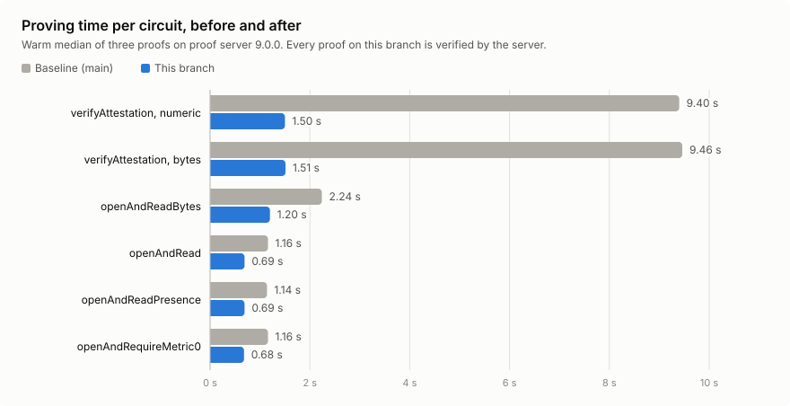
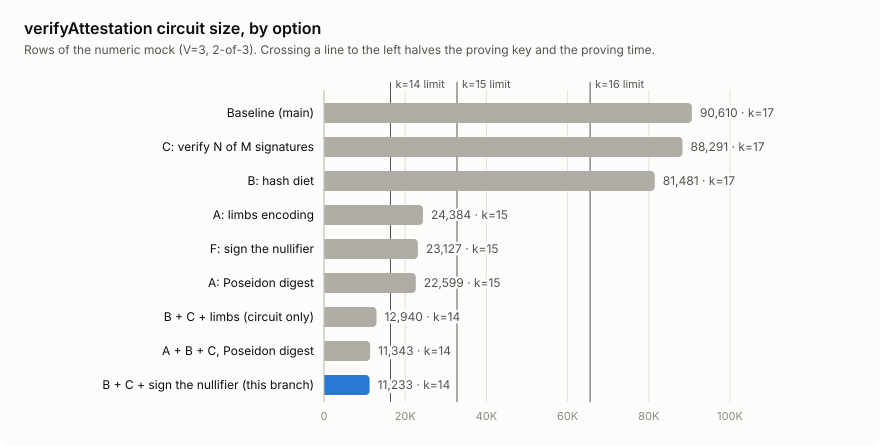
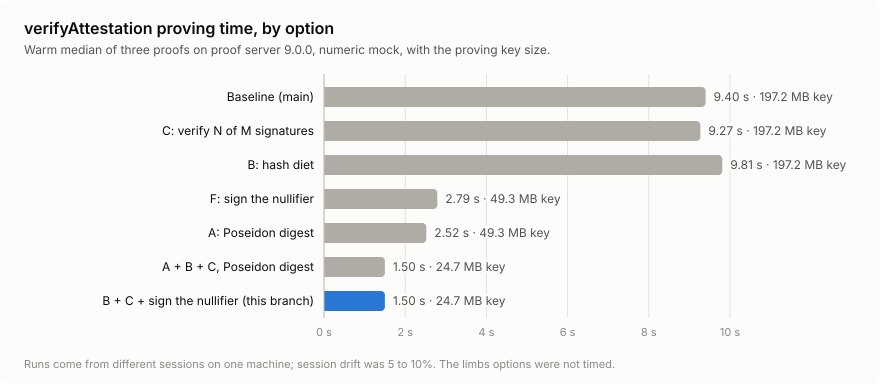
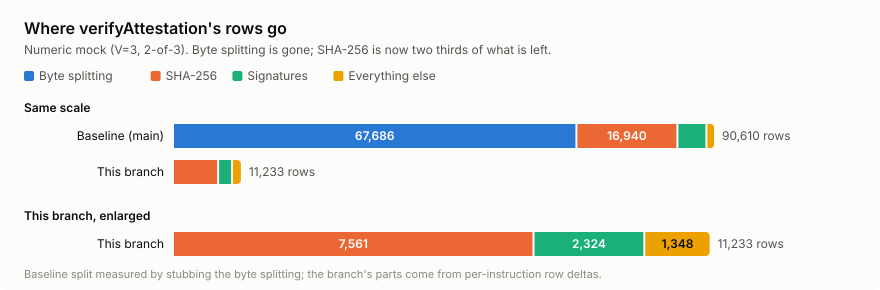
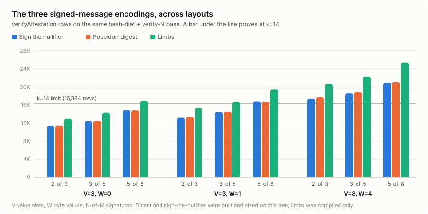
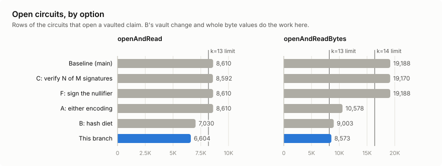
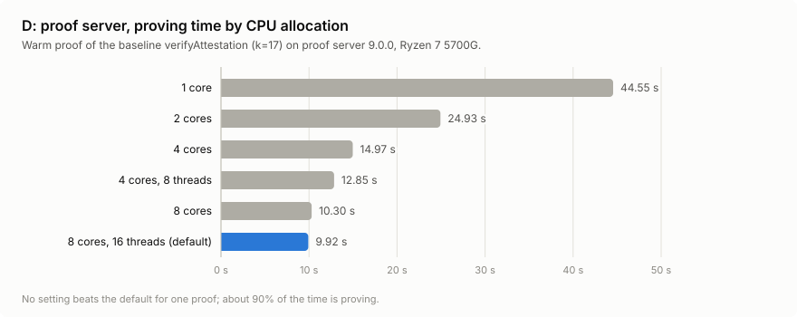

# Proving cost: the options measured

This note compares the ways to make a Thoth claim cheaper to prove, and says
which one the contracts implement. The decisions themselves are ADRs
[0014](../adr/0014-attestors-sign-the-nullifier.md) to
[0017](../adr/0017-vault-pseudonym-survives-network-upgrades.md).

Proving cost follows `k`, the base-2 logarithm of the circuit's row count
rounded up. One `k` step roughly doubles the proving key and the proving time,
so the charts mark the row limits: 8,192 (`k = 13`), 16,384 (`k = 14`),
32,768 (`k = 15`) and 65,536 (`k = 16`).

## Result

The contracts implement B + C + "sign the nullifier". Against the layout
before it, on the numeric mock (`V = 3`, 2-of-3):

| Circuit                         | Before                                        | Now                                        |
| ------------------------------- | --------------------------------------------- | ------------------------------------------ |
| `verifyAttestation`             | 90,610 rows, `k = 17`, 197.2 MB key, 9.40 s   | 11,233 rows, `k = 14`, 24.7 MB key, 1.50 s |
| `verifyAttestation`, bytes mock | 94,629 rows, `k = 17`, 197.2 MB key, 9.46 s   | 13,179 rows, `k = 14`, 24.7 MB key, 1.51 s |
| `openAndRead`                   | 8,610 rows, `k = 14`, 24.6 MB key, 1.16 s     | 6,604 rows, `k = 13`, 12.3 MB key, 0.69 s  |
| `openAndReadPresence`           | 8,580 rows, `k = 14`, 24.6 MB key, 1.14 s     | 6,574 rows, `k = 13`, 12.3 MB key, 0.69 s  |
| `openAndRequireMetric0`         | 8,570 rows, `k = 14`, 24.6 MB key, 1.16 s     | 6,564 rows, `k = 13`, 12.3 MB key, 0.68 s  |
| `openAndBindHost`               | 14,633 rows, `k = 14`, 24.6 MB key, not timed | 12,627 rows, `k = 14`, 24.6 MB key, 1.25 s |
| `openAndReadBytes`, bytes mock  | 19,188 rows, `k = 15`, 49.3 MB key, 2.24 s    | 8,573 rows, `k = 14`, 24.6 MB key, 1.20 s  |

Times are the warm median of three proofs. A proof is 5,772 bytes in every
row.

## How the numbers were taken

- **Machine:** Ryzen 7 5700G (8 cores, 16 threads), 31 GiB.
- **Toolchain:** Compact compiler 0.36.1, `compact-runtime` 0.21.0, proof
  server 9.0.0 in Docker with its default settings.
- **Rows and `k`:** `zkir-v3 mock-compile` on each circuit's zkir. They are
  deterministic.
- **Times:** `npm run bench --workspace=packages/contracts`
  ([`proving.bench.ts`](../../packages/contracts/bench/proving.bench.ts)). It
  takes each circuit's proof inputs from the simulator and proves them on the
  proof server, which checks each proof against the verifier key it is sent.
- **Sessions:** the options were benchmarked in different sessions on the same
  machine, and unchanged circuits drifted 5 to 10% between sessions. The
  "before" column and the last two options in the table below are exact for
  rows, `k` and key size, and approximate for time ratios.

## The options

Each option was built as a separate change on the same base, then combined.

| Option                     | What it changes                                                                                                        | `verifyAttestation` rows (`k`) | Warm proof | State          |
| -------------------------- | ---------------------------------------------------------------------------------------------------------------------- | ------------------------------ | ---------- | -------------- |
| Baseline                   | nothing                                                                                                                | 90,610 (17)                    | 9.40 s     | measured       |
| A: Poseidon digest         | attestors sign one field, a Poseidon hash of the claim                                                                 | 22,599 (15)                    | 2.52 s     | tested, proved |
| A: limbs                   | attestors sign each 32-byte field as its two native field elements                                                     | 24,384 (15)                    | not timed  | tested         |
| F: sign the nullifier      | attestors sign the nullifier, `version` and `holder`                                                                   | 23,127 (15)                    | 2.79 s     | tested, proved |
| B: hash diet               | one SHA-256 block for the holder commitment, the vault keyed by the nullifier, byte values compared without reassembly | 81,481 (17)                    | 9.81 s     | tested, proved |
| C: verify N of M           | the prover names N registry slots and the circuit verifies only those                                                  | 88,291 (17)                    | 9.27 s     | tested, proved |
| B + C + limbs              |                                                                                                                        | 12,940 (14)                    | not timed  | compiled only  |
| A + B + C, digest          |                                                                                                                        | 11,343 (14)                    | 1.50 s     | tested, proved |
| B + C + sign the nullifier | what the contracts implement                                                                                           | 11,233 (14)                    | 1.50 s     | tested, proved |

### Why the signed message dominated

The signed message was a flat list of fields in which each 32-byte claim field
was cut into two 16-byte halves. A circuit holds a `Bytes<32>` as two field
elements, bytes 0 to 30 and byte 31, so cutting at byte 16 makes the compiler
decompose it byte by byte: 13,732 rows per field, five fields per claim. A
value that is already a `Bytes<16>` casts to a field in about 100 rows.

Options A (both forms) and F replace that message. They are alternatives to
each other. B and C attack what is left and stack with any of the three.

### The three encodings

|                                                           | Poseidon digest                                      | Limbs                                            | Sign the nullifier                                                                   |
| --------------------------------------------------------- | ---------------------------------------------------- | ------------------------------------------------ | ------------------------------------------------------------------------------------ |
| Attestors sign                                            | 1 field: a Poseidon hash of the layout and the claim | 14 + 2V + 3W fields                              | 7 fields: `version`, V, W, and the nullifier and `holder` as two field elements each |
| Attestors compute                                         | Midnight's Poseidon over the claim                   | nothing beyond the claim                         | SHA-256 over the observation's bytes                                                 |
| Adds an assumption                                        | Poseidon collision resistance for the signed message | no                                               | no: the vault already relies on SHA-256                                              |
| Depends on a hash that may change across network upgrades | yes (`transientHash`)                                | no                                               | no                                                                                   |
| Catch                                                     | the new assumption                                   | 1,600 to 4,300 more rows; reaches `k = 15` first | a change to the observation struct or its hash changes what attestors sign           |

On the same B + C base, sign the nullifier and the digest land on the same `k`
in all nine layouts tried and stay within 350 rows of each other.

| V   | W   | N-of-M | Sign the nullifier | Poseidon digest | Limbs       |
| --- | --- | ------ | ------------------ | --------------- | ----------- |
| 3   | 0   | 2-of-3 | 11,233 (14)        | 11,343 (14)     | 12,940 (14) |
| 3   | 0   | 3-of-5 | 12,420 (14)        | 12,465 (14)     | 14,260 (14) |
| 3   | 0   | 5-of-8 | 14,813 (14)        | 14,728 (14)     | 16,897 (15) |
| 3   | 1   | 2-of-3 | 13,179 (14)        | 13,310 (14)     | 15,260 (14) |
| 3   | 1   | 3-of-5 | 14,367 (14)        | 14,432 (14)     | 16,604 (15) |
| 3   | 1   | 5-of-8 | 16,750 (15)        | 16,683 (15)     | 19,347 (15) |
| 8   | 4   | 2-of-3 | 17,314 (15)        | 17,664 (15)     | 20,639 (15) |
| 8   | 4   | 3-of-5 | 18,500 (15)        | 18,784 (15)     | 22,200 (15) |
| 8   | 4   | 5-of-8 | 20,891 (15)        | 21,043 (15)     | 25,341 (15) |

These layouts were sized, not proved. The limbs column was compiled without
its tests or off-chain code.

### The open circuits

The circuits that open a vaulted claim were one SHA-256 commitment over the
whole claim plus the vault pseudonym. B keys the vault by the nullifier, which
is a smaller hash, and stops reassembling a byte value from halves before
comparing it. A's change to whole `Bytes<32>` byte values gives
`openAndReadBytes` the same saving by another route.

## The proof server

Option D left the circuits alone and measured the proof server.

- **Settings:** no setting proves one proof faster than the default. About 90%
  of a `k = 17` proof is proving.
- **Memory:** `k = 17` needs more than 2.5 GB; at that limit the whole server
  is killed, not only the request. 3 GB works. A server that only proves
  `k = 14` runs in 400 MB.
- **First proof:** the server parses a proving key the first time it sees it
  and caches five keys. That parse is the first-proof penalty: about 3.5 s at
  `k = 17`, 0.3 s at `k = 14`.
- **Key upload:** every request uploads the full proving key, as midnight-js
  does too. The server cannot look contract keys up itself.
- **Concurrency:** two workers (the default) give 38% more `k = 17`
  throughput than one, at 14 s per proof; four give 50%, at 26 s and about
  7 GB.
- **Alternatives:** versions 9.0.1 and 9.0.2 and the 9.0.0 binary outside
  Docker match the image. In-process proving with the `zkir-v3` WASM package
  is single-threaded: 33.7 s for a `k = 14` proof the server does in 1.25 s.
- **Trust:** a proof server sees the holder secret and the claim. A shared or
  remote one has to be trusted with them.

## What is not verified

- **Independent review:** nobody outside the experiments has reviewed the
  registry's own Schnorr check (ADR 0015), which replaces the standard
  library's verify. The tests catch a weakened check only because honest
  signatures stop verifying; none forges a signature against it.
- **Pseudonym stability:** the vault pseudonym (ADR 0017) assumes
  `degradeToTransient` and the Jubjub curve keep their behavior across
  network upgrades.
- **Toolchain coupling:** the signed message depends on how compiler 0.36.1,
  runtime 0.21.0 and proof server 9.0.0 represent a 32-byte value. The parity
  tests and the benchmark catch a change.
- **Prover-only failures:** a circuit can pass every simulator test and still
  fail to prove. With these versions, the proof server cannot read the proving
  key of a circuit whose only Jubjub values come from converting a field to a
  scalar. Run the benchmark after any circuit change.
- **Live attestors:** the zkFetch live check was not run against real
  witnesses.
